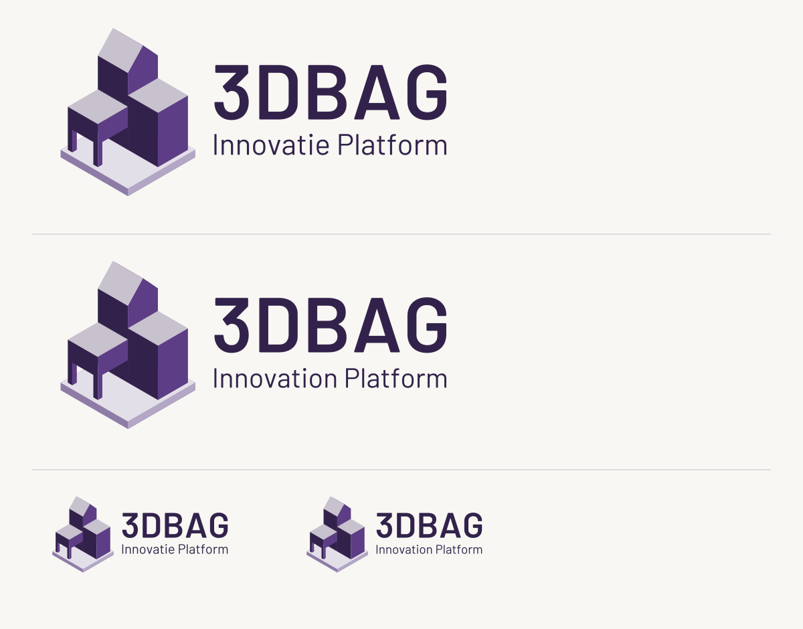

# 3DBAG logo

Three connected isometric building blocks, with a gabled roof on the tall
middle building, a flat orange roof, and an open underpass supported by square
outer corner pillars beneath the left blue block, using the tudelft3d colors from
`../3dbag-docs/overrides/assets/images/logo.svg` and the 3DGI identity palette
from `../3dgi-admin/identity/logo/Color hexa code.JPEG`. The wordmark uses
Barlow SemiBold, matching the Barlow family used in the docs and viewer.


## Files

- `assets/3dbag-logo.svg` — primary horizontal logo.
- `assets/3dbag-icon.svg` — square building symbol.
- `assets/3dbag-logo-reversed.svg` — white wordmark for dark backgrounds.
- Matching transparent PNGs: 1288 × 560 px logos and a 768 × 768 px icon.
- `preview.svg` and `preview.png` — presentation on light and dark backgrounds.

## Purple website variants


The building geometry is identical to the primary logo. These variants use
the website screenshot's deep purple `#32224b`, accent purple `#5d3d85`, and
pale purple `#c8c1ce`. The preview background matches its warm white `#f8f7f3`.
The tagline is outlined Barlow Regular, paired with the Barlow SemiBold wordmark.

- `assets/3dbag-platform-stacked-nl.svg` — “Innovatie Platform” below “3DBAG”.
- `assets/3dbag-platform-stacked-en.svg` — “Innovation Platform” below “3DBAG”.
- `assets/3dbag-icon-purple.svg` and `assets/3dbag-logo-purple.svg` — purple icon and wordmark without a tagline.
- Each SVG has a transparent PNG at four times its native dimensions.
- `preview-platform.svg` and `preview-platform.png` — both languages and smaller header-size examples.

## Square slab variants



The additional `-slab-` variants place the buildings on a square base with an
8-unit-thick edge and a .12-cell margin on all sides of the full footprint.
The base follows the same isometric grid. Its pale top and shaded purple
edges keep the buildings distinct from the platform.

- `assets/3dbag-platform-slab-stacked-nl.svg` and `-en.svg` — tagline below.
- `assets/3dbag-icon-purple-slab.svg` and `assets/3dbag-logo-purple-slab.svg` — icon and wordmark without a tagline.
- Matching transparent PNGs are included for every SVG.
- `preview-platform-slab.svg` and `.png` — slab variant presentation.

In both the original and slab stacked layouts, the visible outlines of
“3DBAG” and the tagline share the same 210-unit width and align at both edges.
Font sizes adjust proportionally; the letters are not stretched.
All platform taglines appear below “3DBAG”. The previous `-horizontal-`
filenames are retained as identical copies of the stacked layouts so existing
links continue to work.

The SVGs contain only vector paths, with outlined lettering and no external
font or image dependencies. Use the SVGs for web headers and scalable artwork.

## Colors

| Source | Color | Hex |
| --- | --- | --- |
| tudelft3d | Blue | `#2d5fc1` |
| tudelft3d | Cyan | `#24a1c8` |
| tudelft3d | Pale blue | `#b4dde6` |
| 3DGI | Orange | `#c76327` |
| 3DGI | Amber | `#ea8d23` |
| 3DGI | Yellow | `#fdc409` |
| Existing header | Wordmark charcoal | `#333333` |

The orange shades match the 3DGI identity reference and are used as flat
fills. Each block shares the same 30-degree isometric grid.
The right flat roof is one-third of the way from the left roof level to
the middle building's gutter: 58 units above ground, between 46 and 82 units.
The passage is transparent negative space between two outer corner pillars,
with no inner pillar beside the middle building, so it works on both light
and dark backgrounds. Each exterior blue wall and its pillars share one
continuous path to prevent rendering seams at their joins.

## Regenerate

With Python 3, `fontTools`, `rsvg-convert`, Barlow SemiBold and Barlow Regular:

```sh
python3 build.py --font /path/to/Barlow-SemiBold.ttf --tagline-font /path/to/Barlow-Regular.ttf
```

Use `--renderer /path/to/rsvg-convert` if the renderer is not on `PATH`.
